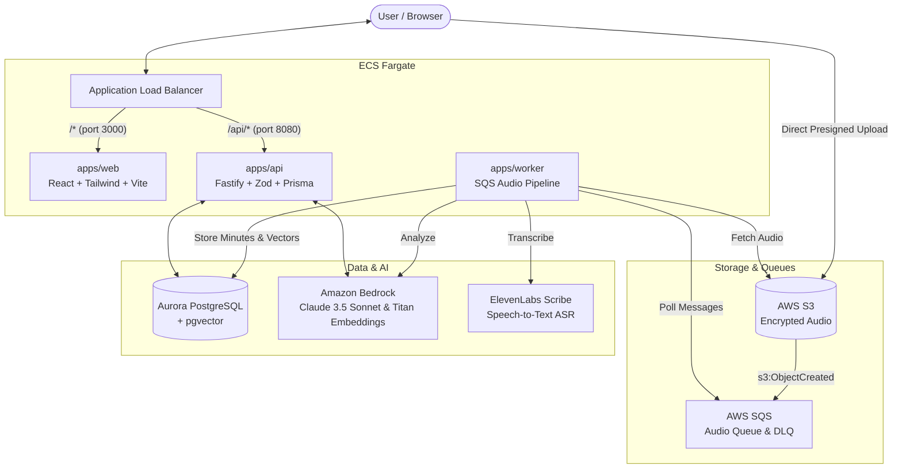

# Dawwen (دوّن) — AI Meeting Assistant

مساعد شخصي ذكي بالذكاء الاصطناعي للاجتماعات التي تستخدم العامية المصرية والإنجليزية المختلطة (Egyptian Arabic & English Code-Switching).

> **Core Value:** Save the time lost after every meeting, never forget what was agreed upon, and ensure that **the final decision always belongs to the human user**.

---

## 🏗 System Architecture



---

## 📦 Monorepo Layout

This repository is managed with **pnpm workspaces** and **TypeScript strict mode**:

```
dawwen/
├── apps/
│   ├── web/           # React 19 + Vite + Tailwind CSS (RTL-first, bilingual ar/en, ports 5173 / 3000)
│   ├── api/           # Fastify backend (Zod validation, Prisma ORM, port 8080)
│   └── worker/        # Node SQS consumer (ffmpeg processing, ASR + Bedrock pipeline)
├── packages/
│   ├── config/        # Validated environment loader & DATABASE_URL builder
│   ├── shared/        # Shared Zod schemas (analysis output schema, proposals, usage)
│   ├── asr/           # Speech-to-Text interface + ElevenLabs & Fake adapters
│   ├── llm/           # Bedrock client + Structured output validation & Fake adapter
│   └── db/            # Prisma schema, migrations, repositories & pgvector integration
├── e2e/               # Playwright end-to-end integration test suite
├── infra/
│   └── terraform/     # Production AWS infrastructure (ECS Fargate, ALB, Aurora, S3, SQS, KMS)
└── docs/
    ├── SPEC.md        # Product specification & core requirements
    ├── DECISIONS.md   # Architectural Decision Records (ADRs 001 - 015)
    └── RUNBOOK.md     # Production operational runbook & incident guides
```

---

## 🛡 Hard Invariants

Every change to Dawwen is guarded by automated invariant tests:

| # | Invariant | Enforcement Mechanism |
|---|-----------|------------------------|
| **1** | **Human-in-the-Loop** | AI agents and automated tools may **ONLY** create `Proposal` records (`PENDING_APPROVAL`). No side effect (calendar scheduling, sending messages, reminders) ever executes without authenticated user approval. |
| **2** | **Transcript Source Attribution** | Every extracted decision, task, and AI answer cites exact transcript segment IDs and timestamps (`[MM:SS]`). |
| **3** | **No Fabrication** | Unstated task owners or due dates remain `null` and are flagged `needsReview: true`. |
| **4** | **Consent Gate** | Audio cannot be uploaded or processed without explicit recorded consent. |
| **5** | **Privacy & Data Minimization** | Raw audio is deleted after transcription or purged by S3 lifecycle retention (0, 7, 30 days). Sensitive tokens, transcripts, and headers are redacted in all logs. |
| **6** | **API Routing Contract** | All API routes live under `/api/*` matching the ALB routing rule. |
| **7** | **Usage Metering & Balance Gating** | Audio uploads and processing are gated on positive balance (`availableMicros > 0`). Every billable operation writes an immutable `usage_events` record with actual micro-dollar costs. |

---

## 🚀 Quickstart (Local Development)

### 1. Prerequisites
- **Node.js**: `v22.x LTS` (or `v24.x`)
- **pnpm**: `>= 9.12.0`
- **Docker & Docker Compose**

### 2. Start Local Infrastructure
Start PostgreSQL (with `pgvector`) and LocalStack (S3 + SQS):
```bash
docker compose up -d
```

### 3. Install Dependencies
```bash
pnpm install
```

### 4. Setup Database
Apply migrations and generate Prisma client:
```bash
pnpm --filter @dawwen/db exec prisma migrate deploy
pnpm --filter @dawwen/db exec prisma generate
```

### 5. Run Development Services
```bash
pnpm dev
```
- **Web App**: `http://localhost:5173` (or port `5174` if busy)
- **API Server**: `http://localhost:8080/api/health`

---

## 🧪 Quality & Testing

Dawwen enforces **0 ESLint warnings**, strict TypeScript, and high test coverage:

```bash
# 1. Monorepo Lint (0 warnings allowed)
pnpm run lint

# 2. Strict Typecheck Across All Workspaces
pnpm run typecheck

# 3. Unit & Integration Test Suite (108+ tests)
pnpm test

# 4. Playwright End-to-End Test Suite
pnpm run test:e2e
```

---

## 🚢 Production Deployment

The AWS infrastructure is defined in `infra/terraform/`:
- **ALB**: Handles SSL termination and routes `/api/*` to the API service and `/*` to the Web service.
- **ECS Fargate**: Runs `web`, `api`, and `worker` tasks with least-privilege IAM roles.
- **Aurora PostgreSQL**: Serverless v2 PostgreSQL with pgvector extension.
- **S3 & KMS**: Audio bucket encrypted with customer-managed KMS key, 7-day auto-expiry lifecycle.
- **Secrets Manager**: Encrypted credentials for database, application secret, Google OAuth, and ElevenLabs API key.

See [`docs/RUNBOOK.md`](docs/RUNBOOK.md) for full deployment procedures, health check validation, and disaster recovery runbooks.
