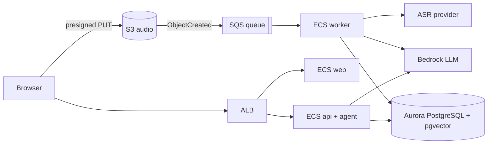

# مساعد الاجتماعات الذكي (AI Meeting Assistant) — توصيف المشروع الكامل

> **الحالة:** مرحلة التخطيط والتصميم (Feature Planning + Architecture)
> **آخر تحديث:** 22 أكتوبر 2026
> **ملاحظة على القراءة:** أي بند مكتوب عليه **[قرار]** اتحسم في النقاش، وأي بند عليه **[مقترح]** لسه محتاج تأكيد أو تجربة.

---

## 1) نظرة عامة

### 1.1 فكرة المنتج
موقع بيقدم **مساعد شخصي بالذكاء الاصطناعي** لأي حد بيعمل اجتماعات كتير: صاحب شغل، مستقل (Freelancer)، أو فريق.

المستخدم بيسجّل الاجتماع بصوته (أو يرفع تسجيل جاهز) ويبعته للمساعد، والمساعد يرجّعله:

1. **ملخص واضح** للاجتماع.
2. **القرارات** اللي اتاخدت.
3. **مهام لكل واحد** فيها **مسؤول + موعد**.
4. **موعد الاجتماع الجاي** محجوز على التقويم **بعد ما المستخدم يأكد**.
5. **متابعة بعد كده:** تذكيرات، مسودات رسايل للعملاء، وإجابات عن أي حاجة اتقالت في اجتماعات قديمة.

### 1.2 القيمة الأساسية
- توفير الوقت اللي بيضيع بعد كل اجتماع.
- عدم نسيان اللي اتفقوا عليه.
- **القرار النهائي دايمًا للمستخدم** (مبدأ تصميم، مش بس شعار).

### 1.3 الشريحة المستهدفة
- أصحاب الشغل والمستقلين اللي بيتعاملوا مع عملاء.
- الفرق الصغيرة.
- **اللغة:** عربي مصري + إنجليزي **من أول يوم**، بما فيها الخلط بين اللغتين في نفس الجملة. **[قرار]**

### 1.4 نموذج الربح
- **الدفع حسب الاستخدام (Pay-as-you-go).** **[قرار]**
- كل عملية (دقايق صوت، tokens) بتتسجّل وتتربط بالمستخدم والاجتماع عشان الفاتورة والتكلفة الفعلية.

---

## 2) المبادئ الحاكمة (Design Principles)

| المبدأ | معناه عمليًا |
|---|---|
| **الإنسان في الحلقة (Human-in-the-loop)** | الـ AI بيقترح، والمستخدم بيعتمد. أي إجراء (حجز، إرسال، تذكير) بيتنفذ بعد زرار "اعتمد". |
| **الشفافية والمصدر** | كل قرار ومهمة جنبها الجملة والتوقيت في التسجيل، عشان المستخدم يتأكد قبل ما يعتمد. |
| **الاختصار قبل التفصيل** | ملخص سريع (TL;DR) فوق، والمحضر الكامل تحته. |
| **مفيش أقسام فاضية** | أي قسم مفيهوش محتوى بيتخفى تلقائيًا. |
| **الصراحة في عدم اليقين** | الأجزاء اللي الـ AI مش متأكد منها بتتعلّم عشان المستخدم يراجعها. |
| **الخصوصية افتراضيًا** | موافقة المشاركين، وحذف الصوت بعد التفريغ، وتشفير. |

---

## 3) رحلة المستخدم الأساسية (Core Flow)

1. المستخدم يسجّل دخول ويفتح الـ Dashboard.
2. يبدأ تسجيل صوتي من المتصفح (أو من اجتماع قادم في التقويم)، أو يرفع ملف صوت.
3. يحدد لغة الاجتماع (أو اكتشاف تلقائي) ويدخل أسماء المشاركين.
4. الملف يترفع **مباشرة لـ S3** والنظام يبدأ المعالجة (تفريغ ثم تحليل).
5. المستخدم يشوف الحالة (بيتعالج → جاهز للمراجعة).
6. شاشة **المراجعة والتأكيد**: يعدّل الملخص والمهام والمسؤولين والمواعيد.
7. يضغط **"اعتمد"** → المحضر يتحفظ، والمهام تتفعّل، وموعد الاجتماع الجاي يتحجز (بعد تأكيد منفصل).
8. بعد كده: تذكيرات، مسودات رسايل، وأسئلة عن اجتماعات قديمة.

### حالات الاجتماع (Status)
`uploaded` → `queued` → `transcribing` → `analyzing` → `review_pending` → `approved`
وفي أي مرحلة ممكن `failed` (مع إمكانية إعادة المحاولة).

---

## 4) الفيتشرز — المرحلة الأولى (MVP)

### 4.1 الحساب والأساسيات
- تسجيل/دخول بإيميل + Google.
- Dashboard رئيسية: اجتماعات قادمة، مهام مفتوحة، آخر الملخصات.
- دعم العربي المصري والإنجليزي والخلط بينهم.

### 4.2 رفع الاجتماع
- تسجيل صوت مباشر من المتصفح.
- رفع ملف صوت (mp3, m4a, wav).
- اختيار لغة الاجتماع أو اكتشافها تلقائيًا.
- إدخال أسماء المشاركين (قبل أو بعد الاجتماع).
- زرار **"ابدأ التسجيل"** مباشرة من اجتماع قادم في التقويم.

### 4.3 المعالجة والتحليل
- **تفريغ صوتي** يدعم العامية المصرية والخلط مع الإنجليزي.
- **ناتج التحليل بهيكل محضر الاجتماعات** (القسم 5).
- **إضافات على الهيكل التقليدي:** قرارات كقسم مستقل، أسئلة مفتوحة، مصدر لكل قرار ومهمة، TL;DR، إخفاء الأقسام الفاضية.
- تمييز الأجزاء اللي الـ AI مش متأكد منها.

### 4.4 المراجعة والتأكيد
- شاشة مراجعة وتعديل قبل الحفظ النهائي.
- زرار **"اعتمد"** هو اللي بيفعّل أي إجراء بعده.
- **سجل التعديلات (Audit/Edit history):** إيه اللي كتبه الـ AI وإيه اللي عدّله المستخدم.

### 4.5 صفحة التقويم والاجتماعات

**أ) التقويم (Calendar View)**
- عرض شهري / أسبوعي / يومي + زرار "النهاردة".
- مزامنة ثنائية الاتجاه مع **Google Calendar**؛ الاجتماعات القادمة بتظهر تلقائيًا.
- ألوان للحالات: قادم / اتلخّص / حصل بدون تسجيل / بيتعالج.
- علامة مميزة للاجتماع اللي الـ AI حجزه بعد تأكيد المستخدم.
- Panel جانبي لتفاصيل الاجتماع من غير ما تسيب الصفحة.

**ب) قايمة الاجتماعات (List View)**
- تبويبين: **القادمة** و**السابقة**.
- بحث وفلترة: التاريخ، العميل/المشروع، المشاركين، الحالة.
- كل صف: العنوان، التاريخ، المشاركين، عدد المهام المفتوحة.

**ج) صفحة تفاصيل الاجتماع (تابات)**

| التاب | المحتوى |
|---|---|
| **الملخص** | TL;DR + المحضر الكامل + القرارات + الأسئلة المفتوحة |
| **المهام** | مسؤول + موعد + أولوية + حالة (جديدة / شغالة / خلصت)، وتغيير الحالة من هنا |
| **النتائج** | القرارات المعتمدة + نسبة تنفيذ المهام (مثلًا 3 من 5) |
| **المتابعة** | مسودات الرسايل والتذكيرات المرتبطة بالاجتماع |
| **النص الكامل** | التفريغ الصوتي، والضغط على جملة يوصّل لمكانها في التسجيل |
| **اسأل عن الاجتماع ده** | شات صغير مقيّد بالاجتماع الحالي |

**د) فيتشرز ذكية في الصفحة**
- تنبيه: "الاجتماع انتهى، ارفع التسجيل عشان نلخصه".
- رابط "الاجتماع السابق مع نفس العميل" لمتابعة اللي كان مفتوح.
- نسبة تقدم المهام لكل اجتماع.

> **"النتائج"** بتتفسّر بمعنيين: (1) مخرجات الاجتماع (قرارات + مهام)، وده متاح من أول يوم، (2) نتايج بعد الاجتماع (هل المهام اتنفذت؟)، وده بيحتاج المستخدم يحدّث الحالة. التاب الحالي بيجمع الاتنين.

### 4.6 التقويم والحجز
- الـ AI يقترح موعد الاجتماع الجاي من الكلام اللي اتقال.
- **الحجز بعد تأكيد المستخدم فقط.**

### 4.7 المتابعة
- تذكيرات بالمهام والمواعيد (إيميل في البداية).
- مسودات رسايل للعملاء (إيميل / واتساب)؛ المستخدم يعدّل ويبعت بإيده.

### 4.8 الذاكرة والبحث
- اسأل عن أي حاجة اتقالت في اجتماعات قديمة، والإجابة تيجي **مع مصدرها** (أنهي اجتماع وأنهي جزء).
- بحث نصي في كل الاجتماعات.

### 4.9 الاستخدام والفوترة (حسب الاستخدام)
- عداد واضح للدقايق المسجلة.
- رصيد/فواتير وسجل استهلاك.
- تنبيه قبل ما الرصيد يخلص.

### 4.10 الخصوصية والأمان
- تنبيه موافقة المشاركين على التسجيل.
- خيار حذف الصوت بعد التفريغ (ومتطبق كحذف تلقائي بعد مدة محددة).
- تشفير + حذف نهائي بطلب المستخدم.

---

## 5) هيكل ناتج التحليل (Meeting Minutes Output)

الهيكل مبني على **محضر الاجتماعات التقليدي (8 مكونات)** مع إضافات المنتج. **[قرار]**

### 5.1 المكونات الثمانية ومصدر كل واحد

| # | العنصر | مصدره |
|---|---|---|
| 1 | التاريخ والوقت | تلقائي من التقويم أو وقت التسجيل |
| 2 | المشاركين | من دعوة التقويم، ويتكمّل من الصوت أو يدويًا |
| 3 | الغرض من الاجتماع | الـ AI يستنتجه من أول الاجتماع أو عنوان الدعوة |
| 4 | بنود الأجندة | من وصف الدعوة لو موجود، وإلا الـ AI يطلّعها من المواضيع اللي اتناقشت |
| 5 | مناقشة المواضيع | الـ AI من التفريغ، مقسّمة بالموضوع |
| 6 | الـ Action items | الـ AI، مع المسؤول والموعد والأولوية |
| 7 | الاجتماع الجاي (التاريخ والمكان) | الـ AI يقترح، والحجز بعد التأكيد |
| 8 | المستندات | روابط/ملفات اتذكرت في الاجتماع أو المستخدم يرفعها |

### 5.2 الإضافات على الهيكل التقليدي
- **القرارات** كقسم مستقل (قلب المنتج).
- **الأسئلة المفتوحة** (اتقالت ومحدش حسمها).
- **المصدر** لكل قرار ومهمة (الجملة + التوقيت).
- **TL;DR** في أول المحضر (3 إلى 5 سطور).
- **إخفاء أي قسم فاضي** تلقائيًا.

### 5.3 طبقتين للعرض
1. **الملخص السريع (TL;DR):** أهم قرار وأقرب مهمة.
2. **المحضر الكامل** تحته.

### 5.4 الـ JSON المقترح (Structured Output)

```json
{
  "meta": { "date": "", "time": "", "language": "", "participants": [] },
  "tldr": "",
  "purpose": "",
  "agenda": [],
  "topics": [{ "title": "", "summary": "", "source_ts": "" }],
  "decisions": [{ "text": "", "source_ts": "" }],
  "action_items": [{ "task": "", "owner": "", "due": "", "priority": "", "source_ts": "" }],
  "open_questions": [],
  "next_meeting": { "proposed_datetime": "", "place": "", "status": "pending_confirmation" },
  "documents": []
}
```

نفس الـ JSON بيغذّي التقويم والمهام والتذكيرات ومسودات الرسايل، فمفيش حاجة بتتكتب مرتين.

> **[مقترح]** إضافة حقل `confidence` (أو علامة `needs_review`) لكل عنصر عشان تمييز الأجزاء غير المؤكدة.

---

## 6) الأدوار والصلاحيات

| الدور | الصلاحيات |
|---|---|
| **Owner (صاحب الحساب)** | كل حاجة + الفوترة |
| **Member (عضو فريق)** | يرفع اجتماعات، ويشوف اللي اتشارك معاه ومهامه |
| **Guest (ضيف)** | يشوف ملخص واحد بلينك فقط |

- المستقل لوحده = Owner بس.
- الفرق والأدوار بتتضاف في **المرحلة التانية**.

---

## 7) الفيتشرز — المرحلة التانية

- تذكيرات وإرسال مهام على **واتساب**.
- إرسال المهام تلقائيًا للمسؤولين (بعد موافقة المستخدم).
- ربط **Zoom / Google Meet / Teams** لتسجيل تلقائي.
- **تمييز المتحدثين (Speaker diarization)** — *ملاحظة:* ممكن يتنقل للـ MVP لأن "مسؤول كل مهمة" بيعتمد على مين قال إيه، أو بديل مؤقت إن المستخدم يربط الأصوات بالأسماء بنفسه.
- تقارير أسبوعية: اللي اتعمل واللي متأخر.
- تصدير: PDF, Notion, Trello, Asana.
- قوالب ملخص حسب نوع الاجتماع (عميل، فريق، مقابلة).
- مجلدات/مشاريع وعملاء.
- فرق وصلاحيات (Owner / Member / Guest) ولينك مشاركة للملخص.

---

## 8) تصميم الـ Agent (المساعد التفاعلي)

### 8.1 التفرقة بين جزئين
- **التحليل بعد الاجتماع:** workflow ثابت (pipeline) مش agent؛ أرخص وأثبت وأسهل في الاختبار.
- **المساعد التفاعلي** (اسأل عن اجتماعات قديمة، اكتب مسودة): هو الـ agent الحقيقي (tool use).

### 8.2 الأدوات (Tools) المقترحة
| الأداة | الوظيفة | نوعها |
|---|---|---|
| `search_meetings` | بحث دلالي/نصي في الاجتماعات | قراءة |
| `get_tasks` | استرجاع المهام وحالاتها | قراءة |
| `draft_message` | كتابة مسودة رسالة لعميل | إنشاء مسودة |
| `propose_event` | اقتراح حجز اجتماع في التقويم | **اقتراح (Proposal)** |

### 8.3 قاعدة الأمان
أي أداة بتنفّذ فعل (حجز، إرسال، تذكير) **بتعمل Proposal فقط**، ومبتتنفذش إلا لما المستخدم يضغط **"اعتمد"**. المبدأ ده متطبّق في الكود نفسه، مش بس في الواجهة.

### 8.4 مكان التشغيل
- **[مقترح]** تشغيل الـ agent جوه خدمة الـ API على ECS باستخدام **Amazon Bedrock (Converse API) مع tool use**.
- **Amazon Bedrock AgentCore** (خدمات مُدارة للـ agents: Runtime, Memory, Gateway...) خيار للمستقبل، مش لازم للـ MVP.

---

## 9) التفريغ الصوتي (Speech-to-Text)

### 9.1 التحدي
العامية المصرية المخلوطة بالإنجليزي هي **أكبر مخاطرة تقنية** في الـ MVP. قايمة Amazon Transcribe الرسمية فيها عربي خليجي (ar-AE) وفصحى (ar-SA) ومفيهاش مصري صريح.

### 9.2 المرشحين (الأسعار لساعة صوت — تقريبية، راجعها قبل القرار)

| الخيار | الأداء | السعر التقريبي | ملاحظات |
|---|---|---|---|
| **ElevenLabs Scribe v2 (batch)** | الأفضل عمومًا في بنشمارك مستقل (مايو 2026) على المصري-الإنجليزي | **~$0.22** | تمييز المتحدثين اختياري، إضافات (keyterm ~$0.05، entity ~$0.07)، خارج AWS |
| **Speechmatics (Enhanced)** | موديل ثنائي عربي-إنجليزي (أرقام التفوق من الشركة نفسها) | ~$0.24 – $0.40 | لم يدخل البنشمارك المستقل |
| **OpenAI gpt-4o-transcribe** | كان ضمن البنشمارك | ~$0.36 (تقدير) | خارج AWS |
| **Whisper Large مستضاف** (ECS/SageMaker) + تصحيح بـ LLM | يحتاج قياس | تكلفة GPU غير محسوبة | تحت سيطرتك وفي AWS؛ تشغيل أثقل |
| **Amazon Transcribe** | ملوش مصري صريح، خارج البنشمارك | ~$1.44 (أول شريحة) | Baseline للمقارنة فقط |

### 9.3 الترشيح الحالي **[مقترح]**
- **البناء على ElevenLabs Scribe v2** كخيار أول (أداء + تكلفة).
- **Speechmatics Enhanced** كمنافس في التجربة.
- Whisper المستضاف كخطة بديلة لو احتجت تحكم أو سيادة بيانات أو لما الحجم يكبر.
- **عزل طبقة التفريغ وراء interface واحد** عشان تبديل المزود ميغيّرش باقي النظام.

### 9.4 خطة التجربة (Bake-off) — أسبوع
1. اجمع 20 إلى 30 مقطع من اجتماعات حقيقية (بموافقة أصحابها): هادي، فريق فيه تداخل، موبايل في مكان زحمة.
2. اكتب نص مرجعي بإيدك لـ 5 مقاطع على الأقل.
3. قيس **WER بعد توحيد كتابة الإنجليزي** (لاتيني ولا عربي)، وقيس التشابه الدلالي (لأن WER بيعاقب النقل الصوتي الصحيح).
4. **الأهم:** شغّل نفس prompt التحليل على كل نص وقارن القرارات والمهام الناتجة.
5. سجّل التكلفة لكل دقيقة وزمن المعالجة ودعم diarization.

### 9.5 اعتبارات
- لو المزود خارج AWS، الصوت هيسيب حساب AWS: لازم صيغة موافقة المشاركين تغطي ده، وتراجع سياسة الاحتفاظ بالبيانات وخيار عدم التخزين.
- تحقق من حدود حجم/طول الملف عند المزود، والاجتماعات الطويلة ممكن تحتاج تقسيم قبل الإرسال.

---

## 10) المعمارية على AWS

**[قرار]** استخدام AWS للـ agent والتفريغ والمعالجة والداتابيز والنشر، والموقع كحاويات على **ECS**.

### 10.1 الرسم العام



### 10.2 المكونات

| المكون | الخدمة | ملاحظة |
|---|---|---|
| الموقع والـ API | **ECS Fargate** خلف ALB | 3 services: `web` و`api` و`worker` |
| الـ Images | **ECR** | scan تلقائي للثغرات |
| تسجيل الدخول | **Cognito** (+ Google federated) | **[مقترح]**، لسه مش في الـ Terraform |
| تخزين الصوت | **S3** | رفع مباشر، تشفير KMS، حذف تلقائي بعد مدة |
| الـ Pipeline | **SQS** (+ **Step Functions** لاحقًا) | في الـ skeleton: S3 → SQS → worker على ECS |
| التفريغ | ElevenLabs / Speechmatics / Whisper / Transcribe | حسب نتيجة التجربة |
| تحليل الاجتماع والـ agent | **Bedrock** | يطلّع الـ JSON، ويشغّل المساعد التفاعلي |
| الداتابيز | **Aurora PostgreSQL Serverless v2** | |
| البحث والذاكرة | **pgvector** في نفس الداتابيز | أبسط من OpenSearch للـ MVP |
| التذكيرات | **EventBridge Scheduler + SES** | **[مقترح]**، واتساب في المرحلة 2 |
| الأسرار والتوكنات | **Secrets Manager + KMS** | توكنات Google Calendar وغيرها |
| الأمان | **WAF + VPC endpoints + private subnets** | WAF لسه مش في الـ Terraform |
| المراقبة | **CloudWatch** (+ X-Ray) | |
| النشر | GitHub Actions أو CodePipeline + **Terraform** | |

### 10.3 تدفق المعالجة (Pipeline)
1. المتصفح يطلب presigned URL من الـ API.
2. المتصفح يرفع الصوت **مباشرة لـ S3** (مش عن طريق الـ API).
3. S3 تبعت حدث على SQS عند انتهاء الرفع (مسار `uploads/`).
4. الـ worker يستقبل الرسالة وينادي مزود التفريغ.
5. الـ worker يشغّل تحليل LLM على النص → JSON منظم.
6. حفظ النتيجة في الداتابيز + عمل embeddings للبحث.
7. تحديث حالة الاجتماع إلى `review_pending` وإشعار المستخدم.

### 10.4 الريجن **[لم يُحسم]**
على حد علمي مفيش ريجن AWS في مصر. المرشحين القريبين: البحرين، الإمارات، أو ريجنز أوروبا. القيمة الافتراضية في الـ Terraform هي `eu-central-1` كـ placeholder فقط. **اختار الريجن بعد التأكد من توافر Transcribe/Bedrock والموديل المطلوب** من الصفحات الرسمية.

---

## 11) الاستخدام والفوترة (Usage-Based Billing)

- جدول `usage_events`: دقايق صوت، tokens، تكلفة فعلية، مربوطة بـ user وmeeting.
- **سعر الدقيقة للعميل** = تكلفة التفريغ + تحليل الـ LLM + التخزين + هامش. **[لازم يتحسب من أول تجربة فعلية]**
- رصيد/Ledger وتنبيه قبل نفاد الرصيد.
- بوابة الدفع خارج AWS (Paymob / Fawry / Stripe حسب السوق). **[لم يُحسم]**

---

## 12) نموذج البيانات (مسودة عالية المستوى)

> التصميم التفصيلي (الـ Schema) هو **الخطوة الجاية**. دي الكيانات المبدئية فقط.

| الكيان | الغرض |
|---|---|
| `users` | الحسابات |
| `meetings` | الاجتماع: عنوان، تاريخ، لغة، حالة، مصدر الصوت |
| `meeting_participants` | المشاركين وربطهم بالمتحدثين |
| `transcript_segments` | مقاطع النص: متحدث، بداية/نهاية، لغة، نص |
| `meeting_analyses` | ناتج التحليل (JSON) ونسخته وحالته |
| `decisions` | القرارات + المصدر |
| `tasks` | المهام: مسؤول، موعد، أولوية، حالة، مصدر |
| `open_questions` | الأسئلة المفتوحة |
| `documents` | المستندات المرتبطة |
| `calendar_connections` | ربط Google Calendar (توكنات مشفرة) |
| `proposals` | الإجراءات المقترحة المنتظرة اعتماد (حجز، إرسال، تذكير) |
| `follow_up_drafts` | مسودات الرسايل |
| `reminders` | التذكيرات المجدولة |
| `embeddings` | مقاطع للبحث الدلالي (pgvector) |
| `usage_events` / `billing_ledger` | الاستخدام والرصيد |
| `edit_history` | سجل تعديلات المستخدم على مخرجات الـ AI |
| `consents` | موافقات التسجيل للمشاركين |

---

## 13) البنية التحتية كـ كود (Terraform Skeleton)

اتعمل skeleton جاهز في مجلد `meeting-assistant-infra`.

| الملف | المحتوى |
|---|---|
| `versions.tf` | الـ provider والـ backend (S3 state معمول comment) |
| `variables.tf` | الإعدادات: ريجن، أحجام tasks، retention للصوت... |
| `network.tf` | VPC + subnets عامة/خاصة + NAT + S3 endpoint + Security Groups |
| `storage.tf` | S3 للصوت (KMS + حذف تلقائي) + SQS + DLQ + ربط S3 بالـ SQS |
| `database.tf` | Aurora PostgreSQL Serverless v2 + حاويات الـ secrets |
| `iam.tf` | Roles بأقل صلاحيات لكل service |
| `alb.tf` | ALB: `/api/*` للـ api والباقي للـ web (HTTPS لو فيه certificate) |
| `ecs.tf` | ECR + Cluster + 3 services + autoscaling للـ worker على عمق الـ queue |
| `outputs.tf` | مخرجات مفيدة (ALB DNS، URLs، secrets ARNs...) |

### خطوات بعد أول apply
1. املأ الـ secrets: `asr-api-key` و`google-oauth` و`app-secret`.
2. ابني وارفع الـ images لـ 3 ريبوهات ECR وبعدها `force-new-deployment`.
3. فعّل pgvector: `CREATE EXTENSION IF NOT EXISTS vector;`
4. فعّل صلاحية موديلات Bedrock في الكونسول وضيّق `bedrock_resource_arns`.
5. اعمل مستخدم داتابيز بصلاحيات محدودة للتطبيق بدل الـ master user.

> **تنبيه صريح:** الملفات اتراجعت syntax وتطابق المراجع، لكن **متجرّبتش بـ `terraform validate` أو `plan`**. شغّلهم قبل أي apply.

### غير موجود لسه في الـ Terraform
Cognito، CloudFront + Route53 + ACM، WAF، Step Functions بدل الـ worker البسيط، EventBridge Scheduler + SES، CI/CD، Alarms على الـ DLQ.

---

## 14) المتطلبات غير الوظيفية

- **الخصوصية:** موافقة المشاركين، حذف الصوت تلقائيًا بعد `audio_retention_days` (افتراضي 7 أيام)، حذف نهائي بطلب المستخدم.
- **الأمان:** تشفير في التخزين (KMS) وأثناء النقل (HTTPS فقط)، أقل صلاحيات، أسرار في Secrets Manager، الداتابيز في subnets خاصة.
- **الدقة:** تمييز الأجزاء غير المؤكدة، ومصدر لكل مخرج.
- **الموثوقية:** DLQ لإعادة المحاولة، deployment circuit breaker في ECS، وحالات واضحة لكل اجتماع.
- **التكلفة:** تتبع تكلفة كل اجتماع؛ أكبر البنود الثابتة: NAT + ALB + Aurora (الحد الأدنى) + الـ worker.

---

## 15) المخاطر

| الخطر | التخفيف |
|---|---|
| دقة التفريغ للمصري المختلط | تجربة Bake-off بتسجيلات حقيقية قبل التثبيت + عزل الطبقة |
| خصوصية الصوت لو المزود خارج AWS | موافقات + مراجعة سياسة الاحتفاظ + خيار Whisper مستضاف |
| التكلفة غير المتوقعة | `usage_events` من أول يوم + سعر دقيقة محسوب بتجربة فعلية |
| تنفيذ إجراءات غلط بواسطة الـ AI | نمط Proposal + زرار اعتماد في الكود |
| هلوسة في الملخص أو المهام | مصدر لكل عنصر + شاشة مراجعة + علامة عدم اليقين |
| توافر الخدمات/الموديلات حسب الريجن | التحقق قبل تثبيت الريجن |

---

## 16) قرارات اتحسمت (Decision Log)

| القرار | التفاصيل |
|---|---|
| لغة الاجتماعات | عربي مصري + إنجليزي من أول يوم (والخلط بينهم) |
| نموذج الربح | الدفع حسب الاستخدام |
| هيكل التحليل | محضر الاجتماعات (8 مكونات) + القرارات + الأسئلة المفتوحة + المصدر + TL;DR + إخفاء الأقسام الفاضية |
| صفحة التقويم | تقويم + قايمة + تفاصيل بتابات (قسم 4.5) |
| البنية التحتية | AWS؛ الموقع كحاويات على ECS؛ التفريغ والمعالجة والداتابيز على AWS (مع احتمال مزود تفريغ خارجي) |
| البنية كـ كود | Terraform |
| مبدأ التحكم | القرار النهائي دايمًا للمستخدم (Proposal + اعتماد) |

## 17) أسئلة لسه مفتوحة

1. **مزود التفريغ النهائي** (بعد التجربة).
2. **الريجن** على AWS.
3. **الاجتماعات:** حضورية (تسجيل من الموبايل)، أونلاين، ولا الاتنين؟
4. **الشريحة الأولى:** مستقلين، أصحاب شغل، ولا فرق؟ (بيحدد هل نبدأ بدون Team features).
5. **Speaker diarization:** ينتقل للـ MVP ولا نستخدم بديل يدوي؟
6. **لغات واجهة الموقع** (عربي/إنجليزي/الاتنين، واتجاه RTL).
7. **بوابة الدفع** المناسبة للسوق.
8. **Stack الـ frontend والـ backend** (لغات وframeworks).
9. **سعر الدقيقة** للمستخدم بعد حساب التكلفة الفعلية.

---

## 18) خارطة الطريق المقترحة

| المرحلة | المحتوى |
|---|---|
| **0 — تجهيز** | تجربة التفريغ (Bake-off)، حسم الريجن، تصميم الـ Schema |
| **1 — Core Pipeline** | رفع الصوت → تفريغ → تحليل → حفظ → شاشة المراجعة والاعتماد |
| **2 — التقويم والاجتماعات** | Google Calendar + صفحة التقويم والقايمة والتفاصيل |
| **3 — المتابعة والذاكرة** | تذكيرات، مسودات رسايل، بحث، "اسأل عن اجتماع" |
| **4 — الفوترة والإنتاج** | Usage metering، رصيد، WAF، Cognito، CI/CD، مراقبة |
| **5 — المرحلة التانية** | واتساب، تكاملات Zoom/Meet/Teams، تقارير، تصدير، فرق |

---

## 19) الخطوات الجاية المباشرة

1. **تصميم الـ Schema** للداتابيز (اجتماعات، مهام، استخدام، موافقات).
2. **تنفيذ تجربة التفريغ** بمقاطع مصرية حقيقية.
3. كتابة **system prompt التحليل** اللي بيطلّع الـ JSON (عربي + إنجليزي).
4. حسم الريجن وتشغيل `terraform validate/plan`.
